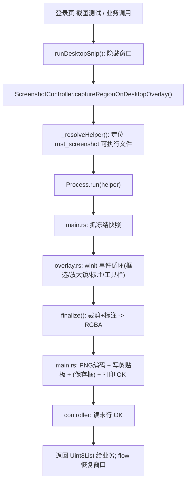

# 截图工具交接文档（Snipaste 式 · 三平台）

> 面向后续接手的工程师 / AI。读完本文应能独立构建、调试、扩展本截图工具。
> 行为契约另见同主题文件 `package/native_screenshot/SPEC.md`。

---

## 1. 一句话总览

整套"自由截图 + 标注"的 UI（冻结快照、框选、放大镜、取色、标注工具栏）由**一个跨平台 Rust 程序**一次写成（`winit` 开窗 + `tiny-skia` 绘制），编译成独立的辅助可执行文件 `rust_screenshot`，随 Flutter 应用一起分发。Flutter 侧只是一个**纯 Dart 包** `native_screenshot`，以**子进程**方式启动该程序、拿回 PNG。

选这个架构的原因：一套代码三端通吃、随包走、Flutter 直接调；且 GUI 事件循环需要独占进程主线程（`dart:ffi` 在 macOS 上做不到全屏覆盖层），独立进程在三端都成立。

### 已实现功能清单

- 冻结快照（多屏/HiDPI 物理像素，截图后界面静止不闪）
- 框选：拖拽、8 手柄缩放、选区内拖动整体移动、点选区外重选
- **窗口自动识别**：悬停高亮光标下窗口、单击即选中、拖拽则自由框选
- 放大镜 + 取色：跟随光标放大；**Shift 切换颜色格式**（Hex/rgb/rgba/hsv）、**C 复制颜色值**
- **光标反馈**：十字 / 方向缩放 / 移动 / 抓取 / 手型 随状态变化
- 标注引擎：矩形/椭圆/箭头/直线/画笔/马克笔/马赛克(真实像素采样)/文字(中文 IME)/序号/橡皮擦(笔刷拖拽、按原图局部擦除) + 撤销重做
- 输出：复制到剪贴板、保存为 PNG（原生对话框）、回传 PNG 给 Flutter
- 快捷键：Esc 取消、Enter 复制、Ctrl+Z/Y、Ctrl+S 保存
- 两个业务入口：隐藏窗口截图 / 不隐藏窗口截图

---

## 2. 组件与目录

### 2.1 Rust 辅助程序 `desktop/rust_screenshot/`（核心）

| 文件 | 职责 |
|---|---|
| `Cargo.toml` | 依赖：`winit`(窗口/输入/IME)、`softbuffer`(把像素缓冲呈现到窗口)、`tiny-skia`(抗锯齿 2D 绘制)、`ab_glyph`(字体轮廓→文字)、`image`(PNG 编码)、`arboard`(剪贴板)、`rfd`(保存对话框)；Windows 用 `windows` crate 抓屏，mac/Linux 用 `xcap`。产物是 `[[bin]] rust_screenshot`。 |
| `.cargo/config.toml` | 仅作用于本 crate 的 rsproxy 国内镜像（加速依赖下载）。 |
| `src/main.rs` | 入口。设 DPI 感知 → 抓冻结快照 → 跑 winit 事件循环 → 根据结果编码 PNG、写剪贴板、（可选）弹保存框 → 在 stdout 打印结果行。Windows release 设 `windows_subsystem="windows"`（无控制台窗口）。 |
| `src/common/types.rs` | `Snapshot`（冻结位图 RGBA + 尺寸 + 原点）、`Rect`（物理像素矩形，含归一化/命中/钳制）。 |
| `src/common/error.rs` | `ScreenshotError` + `Result`。 |
| `src/capture.rs` | `capture_virtual_desktop() -> Snapshot`。Windows：GDI `BitBlt` 整个虚拟桌面 + `GetDIBits` 转 RGBA；非 Windows：`xcap` 枚举显示器、求并集、逐屏拷进大缓冲。 |
| `src/regions.rs` | `detect_regions() -> Vec<Rect>`：枚举可见窗口矩形（topmost-first），供"鼠标悬停自动识别窗口、单击选中"。Windows 用 `EnumWindows` + DWM 真实可见边界（`DWMWA_EXTENDED_FRAME_BOUNDS`，跳过 cloaked/工具窗口）；非 Windows 用 `xcap::Window::all()`。 |
| `src/overlay.rs` | **状态机核心**。`Overlay` 实现 `winit::ApplicationHandler`：建窗、鼠标/键盘/IME 事件、选区+手柄+移动+重选、窗口悬停自动识别、工具分发、`render()` 整帧重绘、`finalize()` 出图。还负责**光标反馈**（`desired_cursor`/`update_cursor`：十字/缩放/移动/手型）与**取色读数**（`ColorFmt`：Shift 切换格式、C 复制）。`Outcome` 是会话结果。 |
| `src/annotations.rs` | `Tool` 枚举、`Annotation` 数据、`PALETTE`/`WIDTHS`、`draw()`(用 tiny-skia 画一条标注；橡皮擦用快照作填充图案，沿笔刷路径还原原始像素以局部擦除)、`hit_test()`(命中拾取，供移动标注)。 |
| `src/toolbar.rs` | 浮动工具栏：`layout()` 计算按钮布局、`hit()` 命中、`draw()` 绘制（含矢量图标）、`ButtonId`。 |
| `src/text.rs` | `TextRenderer`：加载系统字体（含中文），用 `ab_glyph` 取轮廓、`tiny-skia` 填充，得到抗锯齿文字；`measure/ascent/draw`。 |
| `src/clipboard.rs` | `arboard` 写图片（`copy_rgba`）/ 文本（`copy_text`，用于取色复制）到系统剪贴板。 |

### 2.2 Flutter 包 `package/native_screenshot/`（纯 Dart）

| 文件 | 职责 |
|---|---|
| `pubspec.yaml` | 纯 Dart 包（**无** `flutter: plugin:` 段）。 |
| `lib/native_screenshot.dart` | 仅导出 `ScreenshotController`。 |
| `lib/src/screenshot_controller.dart` | `captureRegionOnDesktopOverlay()`：定位助手 exe → `Process.run` → 解析 stdout 末行 → 读回 PNG。`_resolveHelper()` 负责定位。 |
| `SPEC.md` | 行为契约（工具集、快捷键、放大镜、输出、平台注意事项）。 |

### 2.3 业务接入点

- `desktop/lib/common/desktop_snip/desktop_snip_flow.dart` 提供两个入口（都返回选区 PNG，取消为 `null`）：
  - `runDesktopSnip(context)`：**先隐藏/最小化窗口**再截图（本应用不出现在图里），完成后恢复窗口。
  - `runDesktopSnipKeepWindow(context)`：**不隐藏窗口**，直接在当前桌面（含本应用）上截图，适合"截当前界面"。
- 登录页按钮：`desktop/lib/pages/login/view.dart`（`if(!ServiceConfig.isProd)` 下），右下角两个按钮「截图测试」(隐藏窗口) 与「不隐藏软件截图」分别对应上面两个函数。

### 2.4 三平台构建/随包分发接线

| 平台 | 文件 | 做法 |
|---|---|---|
| Windows | `desktop/windows/CMakeLists.txt` | 构建时 `cargo build --release`，`install(PROGRAMS ...)` 把 `rust_screenshot.exe` 拷到 app 同目录。 |
| Linux | `desktop/linux/CMakeLists.txt` | 同上，拷到 bundle 根（与可执行文件同级）。 |
| macOS | `desktop/macos/Podfile`（`post_install`） | 用 `xcodeproj` 向 Runner target 注入一个 Run Script 阶段：`cargo build --release` → 拷进 `*.app/Contents/MacOS/` → ad-hoc 签名。幂等（按阶段名去重）。 |

---

## 3. 运行时数据流



### 进程间协议（stdout 末行）

- `OK <png绝对路径>`：成功。Dart 读取该临时 PNG（读后删除）。剪贴板此时已写好。
- `CANCELLED`：用户取消，Dart 返回 `null`。
- `ERROR <msg>`：失败，Dart 返回 `null`。

### 助手定位顺序（`_resolveHelper`）

1. 环境变量 `NATIVE_SCREENSHOT_HELPER`（兜底/调试）。
2. 与主程序同目录（`Platform.resolvedExecutable` 旁，发布包）。
3. 开发期：从当前目录与主程序目录向上至多 8 层，找 `rust_screenshot/target/{release,debug}/<bin>` 或 `desktop/rust_screenshot/target/...`。

Windows 二进制名 `rust_screenshot.exe`，mac/Linux 为 `rust_screenshot`。

---

## 4. 坐标系（关键，别踩坑）

所有几何（选区、标注、手柄、放大镜采样）统一用**虚拟桌面物理像素**，与冻结位图同坐标系，叠加层窗口铺满整个虚拟桌面且 1:1。出图时把标注整体平移 `(-sel.x, -sel.y)` 即可，避免任何逻辑/物理像素换算误差。`main.rs` 里已 `SetProcessDpiAwarenessContext(PER_MONITOR_AWARE_V2)`。

---

## 5. 怎么构建 / 调试

### 单独跑 Rust 助手（最快迭代 UI）
```powershell
cd desktop/rust_screenshot
cargo run                 # debug，有控制台日志
cargo build --release     # 出发布版
```
直接运行它就会全屏弹出截图界面；Esc 取消，Enter/点"复制"完成；它会把结果路径打到 stdout。

### 跑整个 App（端到端）
- Windows：`flutter run -d windows`（非 prod，点登录页"截图测试"）。CMake 会自动构建并把助手拷到 app 同目录；开发期 Dart 也能回退到 `target/release`。
- Linux：`flutter run -d linux` / `flutter build linux`。
- macOS：先 `flutter clean`，再 `flutter build macos`（触发 `pod install` 跑 `post_install` 注入构建阶段）。

> 构建机需装 Rust 工具链（`cargo` 在 PATH）。

---

## 6. 如何扩展（最常见的两类改动）

### 6.1 新增一个标注工具
1. `annotations.rs`：在 `Tool` 枚举与 `Tool::ALL` 增加成员；在 `draw()` 增加绘制分支；在 `hit_test()` 增加命中分支（供橡皮擦）。
2. `toolbar.rs`：`glyph()` 里给新工具画一个矢量图标。
3. `overlay.rs`：若是"拖拽型"工具，`begin_tool()`/`on_mouse_move()`/`on_left_up()` 的现有分支基本已覆盖；若是"点一下就放置"型（像序号），参考 `Tool::Serial` 分支。

### 6.2 调整 UI 外观
- 配色/线宽：`annotations.rs` 的 `PALETTE` / `WIDTHS`。
- 工具栏尺寸/圆角/阴影：`toolbar.rs` 顶部常量与 `draw()`。
- 遮罩透明度、选区边框、手柄、放大镜倍率/取色框：`overlay.rs` 的 `render()` 与 `draw_magnifier()`。
- 文字字体候选：`text.rs` 的 `font_candidates()`（按平台）。

### 6.3 改抓屏逻辑
只在 `capture.rs`。三端 UI/标注/输出共用，不用动别处。

---

## 7. 平台注意事项 / 已知限制

- **macOS 权限**：助手是独立可执行文件，首次截屏会**单独**触发"屏幕录制"权限申请（TCC 按二进制授权，不继承主 App）。
- **macOS 签名/分发**：Podfile 脚本只做了 ad-hoc 签名（保证 Apple Silicon 能跑）。正式分发/公证时，把脚本里的 `codesign --sign -` 换成正式身份，并纳入 hardened runtime。如需同时支持 Intel+ARM，用 `cargo build --target x86_64-apple-darwin` 和 `aarch64-apple-darwin` 双架构再 `lipo -create` 合并。
- **Linux Wayland**：无法任意定位窗口、抓屏走 `org.freedesktop.portal.Screenshot`（可能弹系统授权框），全屏覆盖层行为受合成器限制。X11 下与 Windows 体验一致。
- **xcap 版本**：mac/Linux 抓屏依赖 `xcap`（当前 `0.3`，其 `Monitor::x()/y()/width()/height()` 返回 `Result`）。换版本若 API 变化，改 `capture.rs` 即可。**这台开发机是 Windows，没有交叉编译链，mac/Linux 的 `capture.rs` 尚未经过编译验证**，请在对应系统上首次 `cargo build` 跑通。

---

## 8. 当前验证状态

- ✅ Windows：`cargo build`(debug/release) 零警告；助手实测能抓屏 + 弹全屏遮罩 + 跑事件循环；`flutter build windows` 通过且 `rust_screenshot.exe` 已打包到 app 同目录。
- ⚠️ macOS / Linux：构建/分发接线已完成，抓屏代码已按 xcap 0.3 写好，但**需在对应系统上编译并实测**（权限/签名/Wayland 见上）。

---

## 9. 建议的后续 TODO

1. 在 mac/Linux 上各跑通一次端到端，按编译报错微调 `capture.rs`。
2. macOS 通用二进制（x86_64 + arm64）+ 正式签名/公证。
3. 失败可观测性：目前助手出错只在 stdout 打 `ERROR`，可加日志文件便于线上排查。
4. 可选增强（当前 SPEC 未含）：贴图(钉到屏幕)、全局快捷键、固定长宽比、控件级元素识别（当前是窗口级，子控件需 UI Automation / AX API）。
5. 多屏放大镜在副屏边缘的钳制、超大虚拟桌面的性能（必要时只重绘脏区）。
